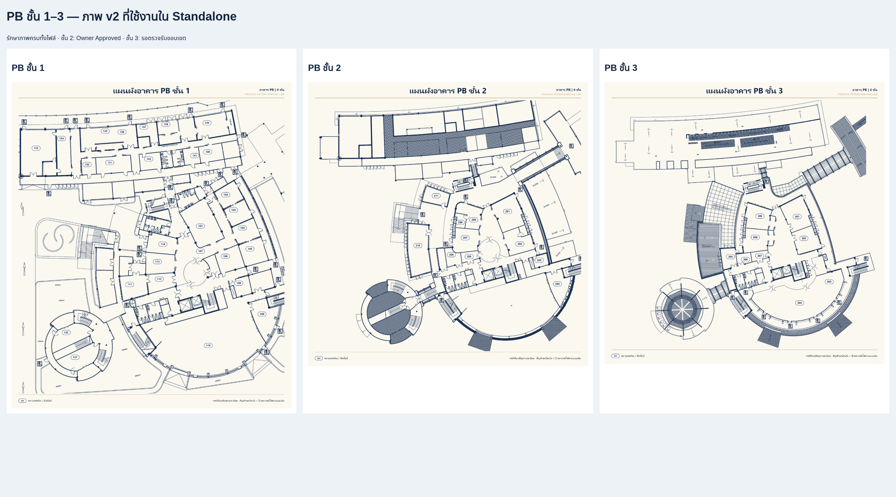

# Final Acceptance — PB ชั้น 3 และความครบถ้วนโครงการ

วันที่ตรวจสอบ: 14 ตุลาคม 2026

## ผลสรุป

ผ่านการตรวจซอฟต์แวร์และความครบถ้วนของภาพ; PB ชั้น 3 ยังรอเจ้าของแบบตรวจรับขอบเขต การยืนยัน Owner Approved PB ชั้น 2 คงเดิม ไม่ถือว่าครอบคลุม PB ชั้น 3 อัตโนมัติ ไม่ Commit, Push หรือ Merge

## ภาพเต็มและภาพเปรียบเทียบ

ไฟล์ใช้งาน `src/assets/floor-layout-revisions/PB-3-v2.png` ขนาด 6098 × 6144 RGBA SHA256 `1fc99c7e7eebaffb4dd218f1f53e006be7d34d69d9c59100fc67f3a918c2e600` ไม่ Crop/วาดเติม ไม่สร้างหมายเลขห้องหรือ Room Hotspots

[เปิด PB ชั้น 3 ความละเอียดเต็ม](qa/pb3-acceptance/PB-3-v2-full.png) · [Screenshot แปลนเต็ม (preview)](qa/pb3-acceptance/plan-full-preview.png)

[เปิดหน้าเปรียบเทียบ PB 1–3 Offline](qa/final-pb-acceptance/comparison-pb-1-3.html) หน้าเปรียบเทียบใช้ภาพ Source ที่ bytes ตรงกับภาพฝังใน Standalone ทั้งสามชั้น ต้องเก็บโครงสร้างโฟลเดอร์โครงการไว้เมื่อเปิด HTML นี้ ส่วน Standalone ของแอปเป็น HTML เดียวไม่พึ่งไฟล์ภายนอก

ภาพในแชต/รายงานอาจถูกย่อเพื่อแสดงผล PNG full ที่ลิงก์ยังคงความละเอียดต้นฉบับ ไม่ re-encode ไม่ Crop

## รายการผ่านและรอตรวจรับ

| รายการ | สถานะ |
| --- | --- |
| ภาพ PB ชั้น 3 v2 โหลดจริงและ embedded bytes ตรง Source | ผ่าน |
| Floor Selector PB ชั้น 1–3, Keyboard, Zoom/Pan/Reset, Back Building/Master | ผ่าน |
| CB 1–4, CSB 1–4 และ PB 1–2 v2 ไม่มีการเปลี่ยนภาพ | ผ่าน |
| Master, พิกัด/fixture Hotspots 21 จุดและข้อมูลอาคาร | คงเดิม |
| Standalone file:// Offline Edge บน Linux | ผ่าน |
| JavaScript errors / HTTP(S) requests จากแอป | ไม่พบ |
| ตัวนับภาพพร้อมแสดง | 11/11 ถูกต้อง |
| PB ชั้น 2 ขอบเขต Owner Approved | คงเดิม |
| PB ชั้น 3 ขอบเขตภาพ/พื้นที่ประกอบและรายละเอียดใกล้ขอบแบบ | รอเจ้าของแบบตรวจรับ |
| PB 2–3 Layout metadata ที่ยัง pending | คงสถานะเดิม รอคำสั่งยืนยันข้อมูล |
| ข้อความ PB 4 ชั้นในภาพ กับ metadata PB 3 ชั้น | คงข้อมูลยืนยันเดิม รอชี้แจงหากต้องเปลี่ยน |
| Microsoft Edge บน Windows บริษัท | **ยังไม่ได้ทดสอบ** |

ภาพ PB ชั้น 3 มีส่วนแรเงาและทางเชื่อมตามต้นฉบับ ไม่พบป้าย/ช่องจอดรถชัดเจน ไม่คาดเดาว่าควรตัดส่วนใดออก ต้องให้เจ้าของแบบยืนยันขอบเขตแยก ไม่มีการแก้ภาพในรอบ Final Acceptance นี้

## หลักฐาน QA

รอบพัฒนา PB ชั้น 3 ล่าสุด Build ผ่าน, Unit Tests 14/14, Browser/Regression 44/44 ผ่าน คงผลดังกล่าวเป็นหลักฐานเดิม ไม่มีการแก้โค้ดแอปหรือสร้าง Standalone ใหม่ในรอบตรวจรับนี้

ผล Final Acceptance รอบนี้: Browser Tests **14/14 ผ่าน** (Chromium Offline 7 + Edge Offline 7) ไม่มี skipped หรือ flaky test

รอบ Final Acceptance ตรวจ PB Floor/KPI และทุก Hotspot ที่ Master Zoom 100/150/200% ใหม่ รวม Keyboard, Desktop/Tablet, Zoom/Pan/Reset และ Back Navigation

ตรวจเพิ่มเติมด้วย Edge Offline: เปิด CB/CSB/PB ครบ 11 ชั้น เปรียบเทียบ embedded image bytes กับ Source ทุกชั้นตรงกัน พร้อมกลับ Master หลังแต่ละอาคาร มี Hotspots 21 จุดและตัวนับ 11/11 ไม่พบ JavaScript errors หรือ network requests: [verification.json](qa/final-pb-acceptance/verification.json)

Microsoft Edge ที่ตรวจจริงคือ 155.0.4283.45 บน Linux ใช้ file:// จริง Chromium cloud ใช้ inline HTML Offline เพราะนโยบายบล็อก file:// ไม่อ้างว่าทดสอบ Windows บริษัทแล้ว

## สถานะภาพครบ 11 ชั้น

| อาคาร | ชั้น | ภาพ |
| --- | --- | --- |
| CB | 1 | CB-1.png คงเดิม |
| CB | 2 | CB-2.png คงเดิม |
| CB | 3 | CB-3.png คงเดิม |
| CB | 4 | CB-4.png คงเดิม |
| CSB | 1 | CSB-1.png คงเดิม |
| CSB | 2 | CSB-2.png คงเดิม |
| CSB | 3 | CSB-3.png คงเดิม |
| CSB | 4 | CSB-4.png คงเดิม |
| PB | 1 | PB-1-v2.png คงเดิม |
| PB | 2 | PB-2-v2.png คงเดิม; Owner Approved |
| PB | 3 | PB-3-v2.png พร้อมแสดง; รอตรวจรับขอบเขต |

## ขนาด Standalone และแนวทางลดขนาดโดยไม่ลดความละเอียด

HTML ปัจจุบัน **90,484,363 bytes = 90.48 MB หรือ 86.29 MiB** รักษาไฟล์ภาพเดิมและภาพ v2 ความละเอียดเต็ม

ทดลอง gzip level 9 ในหน่วยความจำกับ HTML ทั้งไฟล์แล้วได้ **66,997,585 bytes = 67.00 MB ลด 25.96%** ตรวจ decompress กลับได้ bytes เดิมทุก byte ไม่ได้เปลี่ยน HTML ใช้งานหรือภาพ และยังไม่ได้สร้างไฟล์แจกจ่ายที่บีบอัด

แนวทางเสนอ (ยังไม่ดำเนินการ):

1. **แจกเป็น ZIP แล้วแตกด้วย Windows Explorer**: ลดขนาดดาวน์โหลดโดยไม่ลดคุณภาพหรือความละเอียด ผู้ใช้ใช้คำสั่ง Extract All ที่มีใน Windows แล้วดับเบิลคลิก HTML เดิมได้ จำนวน bytes ZIP จริงต้องวัดก่อนแจก ตัวเลข 25.96% เป็นผล gzip ไม่ใช่ผล ZIP และไม่ได้ลดขนาด HTML หลังแตกไฟล์
2. **ฝังเฉพาะภาพที่เลือกใช้งาน**: เก็บภาพ PB เก่าทั้งสามและ Backup ใน Source แต่ไม่ bundle ภาพเก่าที่ถูก Revision แทนแล้ว ภาพเก่า PB รวม 1,428,644 bytes คิดเป็น Base64 ประมาณ 1.90 MB อาจลด HTML ได้ใกล้จำนวนนี้ ต้องตรวจ output จริงและ regression ก่อนยืนยันผล ไม่ลบต้นฉบับ
3. **ทดลองไฟล์อนุพันธ์ PNG ที่บีบอัดใหม่ หรือ lossless WebP**: เก็บ PNG ต้นฉบับทุกไฟล์และความละเอียดเดิม ตรวจ decoded RGBA pixels ตรงทุก pixel ก่อนเลือกอนุพันธ์ ไม่มีการ resize หรือ lossy encoding ผลลดขนาดต้องวัดกับภาพจริงก่อนอนุมัติ วิธีนี้ทำให้ไฟล์ encoded bytes ต่างจากต้นฉบับ จึงไม่ทำโดยอัตโนมัติในงานที่ต้องคง byte-identical

ไม่แนะนำลดความละเอียดหรือใช้ JPEG/WebP แบบ lossy เพราะไม่ตรงข้อกำหนด ไม่เพิ่ม CDN/Server และยังไม่เปลี่ยนวิธีแพ็ก Standalone ในรอบนี้

[หลักฐานขนาดไฟล์และ Git](qa/final-pb-acceptance/git-and-size.json) · [Standalone ล่าสุด](ini-building-layout-standalone.html)

## Git Safety และรายการเปลี่ยนแปลง

Branch `feature/ini-building-layout`, HEAD `563918f14a714a46d8303276db0e33d87fd4425b` ไม่มี Commit/Push/Merge/Force Push ไม่แก้ main รักษา Uncommitted Changes ทั้งหมด ไม่ใช้ reset --hard หรือ clean -fd

ตรวจ git diff --diff-filter=D ไม่พบไฟล์ tracked ถูกลบ ตรวจภาพต้นฉบับและ metadata ที่ต้องรักษายังอยู่ครบ Backup PB 1–3 ตรงกับภาพเก่าทุก byte

รายการ Git Changes ทั้งหมดรวมไฟล์ untracked แบบรายไฟล์อยู่ใน [GIT-CHANGES-FINAL-ACCEPTANCE.txt](qa/final-pb-acceptance/GIT-CHANGES-FINAL-ACCEPTANCE.txt) และ JSON ข้างต้น ไม่แสดงเพียงชื่อโฟลเดอร์

รอบ Final Acceptance นี้เพิ่ม/อัปเดตเฉพาะรายงานและหลักฐาน QA ไม่แก้แปลน/Source UI/Standalone ภาพเปรียบเทียบไม่ใช่แปลนใหม่ หยุดรอการตรวจรับจากเจ้าของแบบก่อนขั้นตอนอื่น
