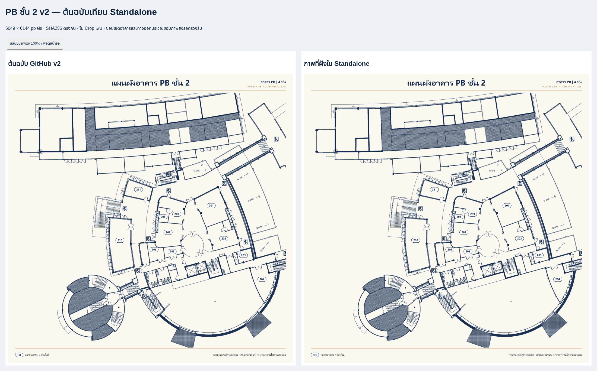
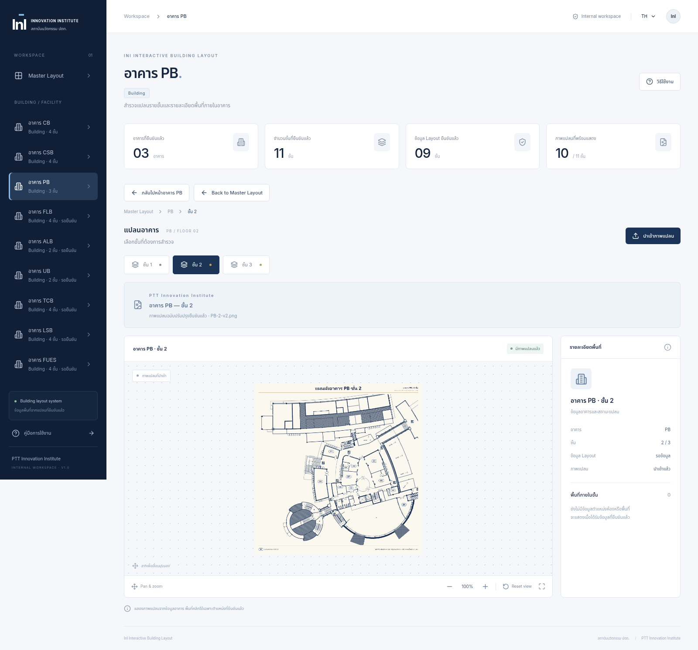

# PB ชั้น 2 v2 — Final Acceptance: Owner Approved

วันที่อัปเดต: 14 ตุลาคม 2026

## สถานะและหลักฐานยืนยัน

**ขอบเขตภาพ PB ชั้น 2 v2: Owner Approved** เจ้าของแบบยืนยันในข้อความ “Owner Confirmation — PB Floor 2 Revision v2” ว่าการตัด METAL SHEET ด้านซ้ายและพื้นที่ส่วนเกินขอบบน/ขอบขวาเป็นการตัดออกโดยตั้งใจ จึงไม่ใช่ข้อบกพร่องหรือข้อมูลสูญหาย ข้อสังเกตรอตรวจรับขอบเขตจากรายงานก่อนหน้าถือว่าปิดแล้วตามคำยืนยันนี้

[บันทึก Owner Approval](qa/pb2-final-acceptance/owner-approval.json)

ไม่ Crop เพิ่ม ไม่วาดหรือแก้ pixels ต้นฉบับ ไม่มีชื่อห้องหรือ Room Hotspots ที่สร้างขึ้นเอง การยืนยันนี้บันทึกขอบเขตภาพเท่านั้น ไม่เปลี่ยนจำนวนชั้นหรือ Layout metadata เดิมที่ไม่ได้รับคำสั่งให้แก้

## ภาพที่ใช้งาน

ต้นทาง GitHub: `src/assets/floor-layouts/PB-2-v2.png` blob `99b3e7f17d8553dfdeb432967ad4f100199e49ab`

ไฟล์ใช้งาน: `src/assets/floor-layout-revisions/PB-2-v2.png` ขนาด 6049 × 6144 RGBA

SHA256: `76bb54b3ab7e28ff7c79301672fea28c33aaaf5637b21ccb8a7276be12825d3d`

ภาพใน Source และภาพที่ฝังใน Standalone ตรงกับต้นฉบับทุก byte รักษาความละเอียดและอัตราส่วนเดิม ที่ Reset 100% แสดงครบทั้งไฟล์ เมื่อ Zoom สามารถ Pan สำรวจรายละเอียดได้ ภาพเก่าและ Backup ยังอยู่ครบ

[เปิดต้นฉบับความละเอียดเต็ม](qa/pb2-final-acceptance/original-v2.png) · [ภาพถอดจาก Standalone ความละเอียดเต็ม](qa/pb2-final-acceptance/standalone-embedded-v2.png) · [หน้าเปรียบเทียบ Offline พร้อมปุ่มขนาดจริง](qa/pb2-final-acceptance/comparison-offline.html)

Screenshot เป็นหลักฐานจากรอบตรวจสอบก่อน Owner Confirmation ข้อความ “รอตรวจรับ” ที่อาจอยู่ในภาพเป็นสถานะในเวลาถ่าย ไม่ใช่สถานะปัจจุบัน หน้าเปรียบเทียบ HTML อัปเดตข้อความเป็น Owner Approved แล้วโดยไม่เปลี่ยนภาพ

## ขอบเขตทั้ง 4 ด้าน

| ด้าน | สถานะล่าสุด |
| --- | --- |
| บน | Owner Approved: ตัดพื้นที่ส่วนเกินโดยตั้งใจ ไม่ใช่ข้อมูลสูญหาย |
| ขวา | Owner Approved: ตัดพื้นที่ส่วนเกินโดยตั้งใจ ไม่ใช่ข้อบกพร่องของอาคาร/ทางออก |
| ซ้าย | Owner Approved: ตัด METAL SHEET โดยตั้งใจ ไม่ต้องนำกลับหรือวาดเติม |
| ล่าง | ภาพแสดงตามไฟล์ v2 ครบ ไม่มีการตัดเพิ่มเติมโดยแอป |

## ผลทดสอบที่คงไว้

| รายการ | ผล |
| --- | --- |
| PB/KPI Interactive Browser Tests รอบตรวจรับ | **6/6 ผ่าน** (Chromium 3 + Edge 3) |
| เลือกชั้น PB 1–2 และ PB ชั้น 3 Placeholder | ผ่าน |
| Keyboard, Zoom, Pan, Reset และ Back Navigation | ผ่าน |
| Desktop/Tablet และอัตราส่วน | ผ่าน |
| Standalone file:// Offline Edge บน Linux | ผ่าน |
| JavaScript errors / HTTP(S) requests จากแอป | ไม่พบ |
| ภาพที่ฝังทั้ง 10 ชั้นตรงกับ Source | ผ่าน |
| Master Hotspots / ตัวนับภาพ | คง 21 จุด / 10 จาก 11 ชั้น |

คงผลทดสอบ 6/6 เดิม ไม่ได้รันซ้ำในรอบอัปเดตเอกสารนี้ ไม่เปลี่ยนโค้ดแอปหรือสร้าง Standalone ใหม่ Artifact เดิมผ่าน Build, Unit Tests 14/14 และ Browser/Regression Tests 42/42 จากรอบพัฒนา

## Data Integrity และข้อจำกัด

ตรวจ SHA256 ก่อน/หลังอัปเดตเอกสาร: ภาพ Master, ภาพ CB/CSB ครบ 8 ชั้น, ภาพ PB ทุกไฟล์ที่มีใน Workspace, Backup, ภาพ Revision PB 1–2, ข้อมูลอาคาร, พิกัด Hotspots และ Standalone ไม่เปลี่ยนแปลง รักษาการเปลี่ยนแปลงที่ยังไม่ Commit ทั้งหมด

**Microsoft Edge บน Windows บริษัท: ยังไม่ได้ทดสอบ** Edge ที่ตรวจ Offline จริงเป็น 155.0.4283.45 บน Linux ส่วน Chromium cloud ใช้ inline HTML Offline เพราะนโยบายบล็อก file:// ไม่รายงานว่าผ่าน Windows

Standalone ประมาณ 67.1 MB เพราะเก็บภาพความละเอียดเต็ม อาจใช้เวลาเปิดและหน่วยความจำมากขึ้น ภาพเขียน PB 4 ชั้น แต่ข้อมูลยืนยันเดิมในระบบเป็น 3 ชั้น คงเดิมโดยไม่อนุมานหรือแก้เอง

## สถานะ PB และงานถัดไป

| ชั้น | ภาพใช้งาน | สถานะ |
| --- | --- | --- |
| PB 1 | PB-1-v2.png | เชื่อมภาพจริงและทดสอบแล้ว คงเดิม |
| PB 2 | PB-2-v2.png | Interactive 6/6 ผ่าน; ขอบเขตภาพ Owner Approved |
| PB 3 | Placeholder | ระบบรองรับชั้นเดิมแล้ว แต่ยังไม่เริ่มเชื่อมภาพหรือสร้างข้อมูลห้อง |

พบภาพ PB ชั้น 3 บน GitHubจากการตรวจครั้งก่อน ระบบมีโครงสร้างเลือกภาพ/Revision, Floor Selector และ Viewer พร้อมใช้เมื่อได้รับคำสั่ง ไม่มีการเลือก PB-3 ใน activeFloorRevisions รอบนี้

ไม่มี Commit, Push, Force Push หรือ Merge ไม่เปลี่ยน Branch main หยุดรอคำสั่งก่อนเริ่ม PB ชั้น 3
