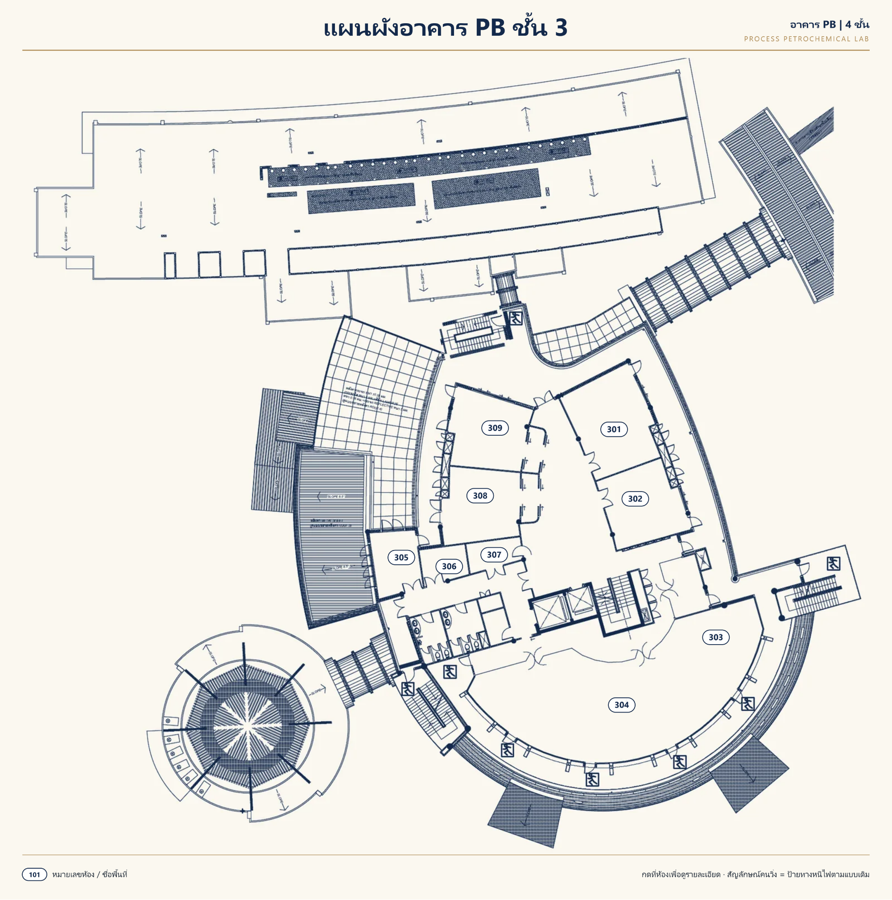
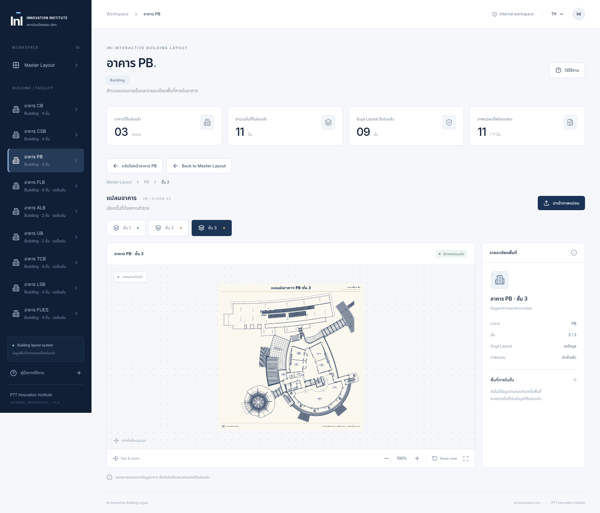

# PB ชั้น 3 v2 — Integration และ Regression QA

วันที่ตรวจสอบ: 14 ตุลาคม 2026

## การเลือกไฟล์และ Source

Branch ปัจจุบัน `feature/ini-building-layout` ฐาน HEAD `563918f14a714a46d8303276db0e33d87fd4425b` รักษา Working Tree ที่ยังไม่ Commit ทั้งหมด

พบ PB ชั้น 3 สองไฟล์บน GitHub: `pb-3.png` (2100 × 1350 RGB) และ `PB-3-v2.png` (6098 × 6144 RGBA) หยุดรอตามคำขอจนผู้ใช้ยืนยัน “ยืนยันว่าจะใช้ PB-3-v2.png” แล้วจึงเชื่อมภาพใหม่

ต้นทาง GitHub: `src/assets/floor-layouts/PB-3-v2.png` blob `7095a32b0f4bd04967424816bf7fa560a45d3754`

ไฟล์ใช้งาน: `src/assets/floor-layout-revisions/PB-3-v2.png`

SHA256: `1fc99c7e7eebaffb4dd218f1f53e006be7d34d69d9c59100fc67f3a918c2e600`

ภาพเดิมเก็บไว้ใน `src/assets/floor-layouts/pb-3.png` และ Backup `src/assets/floor-layout-backups/pb-3-before-v2.png` ตรงกันทุก byte ไม่มีการเขียนทับหรือลบภาพต้นฉบับ

ไฟล์ใหม่อยู่โฟลเดอร์ Revision เดียวกับ PB ชั้น 1–2 เพิ่มเฉพาะ key PB-3 ใน `activeFloorRevisions` ระบบเลือกชั้น 3 โหลดภาพใหม่ได้สำเร็จ จึงแสดงสถานะมีภาพจริงแทน Placeholder ไม่เปลี่ยน metadata อาคาร

## ภาพและขอบเขต

ตรวจภาพด้วยสายตาหัวภาพระบุ “แผนผังอาคาร PB ชั้น 3” ตรงกับ UI ภาพ PNG RGBA 6098 × 6144 เปิดและ decode ใน Edge ได้ครบ ภาพที่ฝังใน Standalone ตรงกับต้นฉบับทุก byte Viewer อ่าน natural dimensions และรักษาอัตราส่วนจริงทั้ง Desktop 1600 และ Tablet 1024

ไม่ Crop ไม่วาดเติม ไม่ลดความละเอียดและไม่สร้าง Room Hotspots หมายเลขห้องที่เห็นมาจากภาพที่ผู้ใช้เลือก ไม่ใช่ข้อมูลห้องที่เพิ่มในระบบ ที่ Reset 100% แสดงครบทั้งไฟล์ เมื่อ Zoom ใช้ Pan สำรวจส่วนที่อยู่นอก viewport ได้

ภาพมีส่วนแรเงา/ทางเชื่อมและแนวเส้นด้านขวาบนที่สิ้นสุดใกล้กรอบแปลน ไม่มีพื้นที่ระบุเป็นลานจอดรถชัดเจน ไม่คาดเดาว่าส่วนใดควรตัดออก จึงไม่ Crop เพิ่ม รอเจ้าของแบบตรวจรับขอบเขต PB ชั้น 3; ไม่ถือว่าคำยืนยัน Owner Approved ของ PB ชั้น 2 ครอบคลุมชั้น 3 โดยอัตโนมัติ

ภาพเขียน PB 4 ชั้น แต่ข้อมูลยืนยันเดิมในระบบยังเป็น 3 ชั้น ไม่ใช้ข้อความภาพเปลี่ยนจำนวนชั้นเอง Layout metadata PB ชั้น 2–3 ยังคง pending เดิม การโหลดภาพได้ไม่เปลี่ยนสถานะยืนยันข้อมูล Layout โดยอัตโนมัติ

## การทดสอบและการรักษาข้อมูล

ผลรอบนี้: Build ผ่าน, Unit Tests 14/14 และ Browser/Regression Tests 44/44 ผ่าน (Chromium Offline 22 + Edge Offline 22) ไม่มี skipped หรือ flaky test

ตรวจ bytes ภาพ CB/CSB ทั้ง 8 ชั้นและ PB ชั้น 1–2 v2 ตรง GitHub ล่าสุดทุก byte Master Map, Hotspots 21 จุด, fixture พิกัดและข้อมูล CB/CSB/PB ตรง HEAD ทุก byte ไม่มีไฟล์ต้นฉบับถูกลบ Owner Approved PB ชั้น 2 และหลักฐานเดิมยังคงอยู่

เพิ่ม Browser Test PB ชั้น 3: ภาพใหม่ embedded SHA256 ตรงต้นฉบับ, natural dimensions 6098 × 6144, aspect ratio Desktop/Tablet, Zoom 200%, Pan/Reset, Back to Building/Master, Floor Selector ชั้น 1–3 และ Keyboard เลือกชั้น พร้อมตรวจว่า PB ชั้น 1 ยังใช้ v2 เดิม ตัวนับภาพจริง 11/11 และ Master Hotspots 21 จุด

รัน Build, Unit Tests และ Browser/Regression Tests ใหม่ทั้งชุด รวม PB ชั้น 1–2, CB/CSB ครบ 8 ชั้นและทุก Hotspot ที่ Zoom 100/150/200% ใช้ SHA256 เพื่อตรวจภาพใหญ่โดยไม่เก็บ Buffer/Base64 ขนาดใหญ่ใน assertion report

Standalone เปิด Offline ใน Microsoft Edge 155.0.4283.45 บน Linux ผ่าน file:// จริง ภาพ PB-3 decode ได้และ bytes ตรงต้นฉบับ ไม่พบ JavaScript errors หรือ HTTP(S) requests จากแอป รวม CSS/JS/Fonts/ภาพใน HTML เดียว ไม่มี CDN หรือ Server

**Microsoft Edge บน Windows บริษัท: ยังไม่ได้ทดสอบ** Chromium ใน cloud ใช้ inline HTML Offline เพราะนโยบายบล็อก file:// ไม่รายงานว่าผ่าน Windows

Standalone ขนาด 90,484,363 bytes (ประมาณ 90.5 MB) เพราะฝัง PB v2 ความละเอียดเต็มครบ 3 ภาพ การเปิดอาจใช้เวลาและหน่วยความจำมากกว่ารุ่นก่อน

## สถานะภาพทั้ง 11 ชั้น

| อาคาร | ชั้น | ภาพที่แสดง | สถานะภาพ |
| --- | --- | --- | --- |
| CB | 1 | CB-1.png | พร้อมแสดง คงเดิม |
| CB | 2 | CB-2.png | พร้อมแสดง คงเดิม |
| CB | 3 | CB-3.png | พร้อมแสดง คงเดิม |
| CB | 4 | CB-4.png | พร้อมแสดง คงเดิม |
| CSB | 1 | CSB-1.png | พร้อมแสดง คงเดิม |
| CSB | 2 | CSB-2.png | พร้อมแสดง คงเดิม |
| CSB | 3 | CSB-3.png | พร้อมแสดง คงเดิม |
| CSB | 4 | CSB-4.png | พร้อมแสดง คงเดิม |
| PB | 1 | PB-1-v2.png | พร้อมแสดง คงเดิม |
| PB | 2 | PB-2-v2.png | พร้อมแสดง; ขอบเขต Owner Approved คงเดิม |
| PB | 3 | PB-3-v2.png | พร้อมแสดงใหม่; รอเจ้าของแบบตรวจรับ |

ตัวนับภาพพร้อมแสดง 11/11 ไม่รวม Backup หรือภาพเก่าซ้ำ จำนวนอาคารยืนยัน 3 แห่ง จำนวนชั้นยืนยัน 11 ชั้น และ Layout ยืนยัน 9 ชั้นคงเดิม

## ภาพตรวจรับและ Standalone

[ภาพเต็มความละเอียด 6098 × 6144](qa/pb3-acceptance/PB-3-v2-full.png)

[Dashboard Tablet](qa/pb3-acceptance/dashboard-1024.png) · [หลักฐาน Offline / hash](qa/pb3-acceptance/verification.json) · [Standalone ล่าสุด](ini-building-layout-standalone.html)

ภาพ preview ย่อเพื่ออ่านในรายงาน แต่ PNG ที่ลิงก์ full เก็บความละเอียดต้นฉบับทุก pixel รูป Dashboard ถ่ายจาก Standalone จริง ส่วน preview แปลนถ่ายโดยขยายภาพ embedded ใน browser context Offline แยกสำหรับตรวจครบทั้งไฟล์

## รายชื่อไฟล์งานรอบนี้

เพิ่ม: `src/assets/floor-layouts/pb-3.png`, `src/assets/floor-layout-backups/pb-3-before-v2.png`, `src/assets/floor-layout-revisions/PB-3-v2.png`, `qa/pb3-acceptance/` และรายงานนี้

แก้ไข: `src/data/floorImages.ts`, `src/data/floorImages.test.ts`, `tests/campus-hotspots.spec.ts`, `ini-building-layout-standalone.html`, `STANDALONE.md`

## รายการรอยืนยัน

ขอบเขต PB ชั้น 3 ตามภาพ v2 โดยเจ้าของแบบ, Layout metadata ชั้น 2–3 ที่ยัง pending เดิม, ความต่างข้อความ PB 4 ชั้นในภาพกับข้อมูลเดิม 3 ชั้น และผลตรวจ Microsoft Edge บน Windows บริษัท ไม่มีการสร้างแปลนหรือห้องสมมติ

ไม่มี Commit, Push, Force Push หรือ Merge ไม่เปลี่ยน main รักษางานที่ยังไม่ Commit ทั้งหมด หยุดรอการตรวจรับจากเจ้าของแบบก่อนดำเนินการขั้นตอนอื่น
